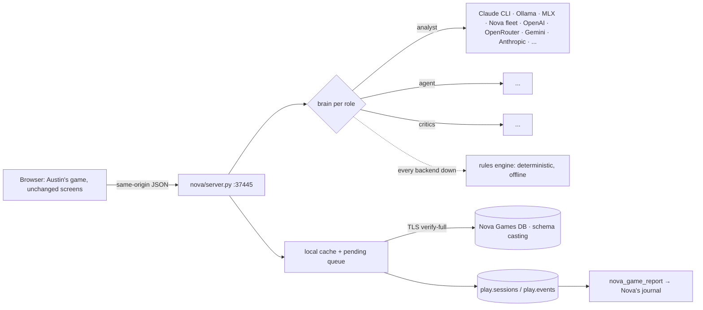

# Casting Director — Nova edition

Austin Fonacier's Casting Director, running on your own machines: local AI instead of Gemini, and the Nova Games
DB instead of Firebase. Nothing reaches Google (apart from the web font).



## Run it

```sh
python3 -m nova.server --setup-credentials   # once: Games DB password into the login Keychain
python3 -m nova.server --migrate             # once: create the casting schema
python3 -m nova.server                       # http://127.0.0.1:37445  (--lan to share on the LAN)
python3 -m nova.server --smoke               # self-test every route, offline
```

The LaunchAgent keeps it running:

```sh
sed -e "s#__HOME__#$HOME#g" -e "s#__REPO__#$PWD#" deploy/net.digitalnoise.casting-director.plist \
    > ~/Library/LaunchAgents/net.digitalnoise.casting-director.plist
launchctl bootstrap gui/$(id -u) ~/Library/LaunchAgents/net.digitalnoise.casting-director.plist
```

## What it adds (from GTNW)

| Feature | How |
|---|---|
| Pick the AI per role | **[SETTINGS]** in the header: analyst (book & budget), agent (fees), critics (results). 13 backends, model list per backend. |
| Keys | Stored in the macOS Keychain by the server; the browser never holds them. |
| Fallback | A dead backend falls through Ollama → MLX → Nova fleet → OpenRouter, then the rules engine. The game never stalls. |
| Retry | 3 tries, 0.5 s / 1 s backoff on timeouts, 408, 429 and 5xx (GTNW's Retry policy). |
| Untrusted output | Every model reply is schema-coerced and clamped (budgets, scores, verdicts) before the game sees it. |
| Games DB | Movies, book/actor caches, achievements, saves, settings and every AI call in schema `casting`; offline writes queue and sync later. DB badge in the header. |
| Play log | Each production is a `play.sessions` row with events (greenlit, quote, released, game_over), so Nova can write about it. |
| Stats | `GET /api/stats`: tokens, tok/s, latency and backend for the last calls. |
| Advisors (phase 2) | After each casting the Studio Exec, Casting Agent and Director give a stance (approve / caution / oppose) and the odds it works. When anyone opposes you can **overrule** them or recast; overrules reach the critics. Stances and odds are house rules; an AI brain (role *advisors*) can write their lines. |
| Production crisis | Before the cameras roll a crisis lands (walk-off, monsoon, bad test screening, tabloids, effects overrun, feud). Each choice has a cost and a hidden effect on the critics' score. |
| Achievements | First Picture, Blockbuster, Critics' Darling, Razzie Night, Two Thumbs Up, Under Budget, Nobody You've Heard Of, Maverick, Crisis Manager — stored in the Games DB, shown on the premiere screen. |

## Security

Loopback by default; same-origin check on every write; 256 KB JSON-only bodies; strict CSP, `X-Frame-Options: DENY`,
no CORS; a static allow-list (no source, tests or dotfiles served); backend URLs must be http(s).

## Tests

`python3 -m pytest nova/tests` covers unit, functional, security, integration, retry, performance and frame tests.
The frame tests play a whole game in headless Chromium and fail if anything goes outside the server.
